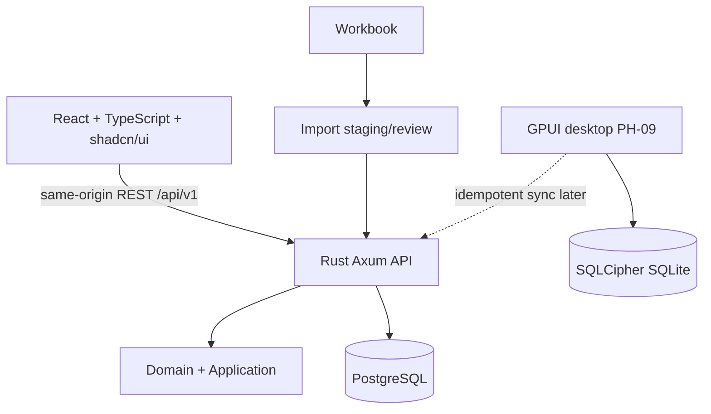

# Arsitektur Aplikasi — Final Baseline

**Status:** baseline disepakati melalui ADR-001–007. Repo kanonis `D:\azka\keuangan-toko`. Perubahan arsitektur yang breaking memerlukan ADR baru.

## Komponen

| Komponen | Keputusan |
|---|---|
| API | Rust stable + Axum + Tokio; OpenAPI `utoipa`; typed TS client digenerasi dari OpenAPI. |
| Web | React + TypeScript + Vite; Tailwind CSS + shadcn/ui; versi stable dan lockfile direkam saat bootstrap. |
| Workspace | Cargo workspace di root; pnpm workspace untuk JS; lockfile wajib di-commit. |
| Persistence | PostgreSQL pusat; SQLx untuk query/migration versioned. |
| Layers | `crates/domain` aturan/invariants; `crates/application` use cases/ports; `apps/api` adapter Axum/Postgres; `apps/web` UI; `crates/money` money/rounding primitives; `crates/contracts` shared serializable API types bila sesuai; `packages/api-client` generated TS client. |
| Desktop | Rust + GPUI + SQLite/SQLCipher setelah web stabil pada PH-09. Folder tidak dibuat sebelum fase tersebut. |

## Layout monorepo

```text
apps/api/                 Axum composition root and HTTP handlers
apps/web/                 React, TypeScript, Vite client
crates/domain/            business entities and invariants
crates/application/       use cases and repository ports
crates/money/             exact IDR and rounding logic
crates/contracts/         Rust wire/domain contracts when shared
packages/api-client/      generated TypeScript client
migrations/postgres/      SQLx migrations
infra/                    container, CI and environment templates
docs/                     product, API, ERD, phase/status and ADR
.agents/skills/           project-local Codex workflows
```

This is an approved target layout; existing docs-only files remain at repo root/`docs` and are not moved. `apps/desktop/` is deferred until PH-09.

## Boundary and data flow



- API owns authentication, authorization, validations, financial posting, balances, FIFO allocation, aging, import approval and audit.
- Domain/application crates do not depend on HTTP or PostgreSQL. Adapters implement ports; React uses typed client only.
- Ledger is append-only; posted sale/payment can only be reversed with audited contra-event. DB transactions and row locks protect money invariants.
- PostgreSQL is the source of truth. Desktop events are provisional until accepted by server.
- Workbook importer is a backend component; parsed data first lands in staging, never directly in official ledger.
- MVP is single shop, no inventory, supplier, cash POS, gateway or third-party auth integration.

## API, migration and frontend generation

REST `/api/v1` is same-origin JSON with the envelope and route details in [API_SPEC](API_SPEC.md). Generate OpenAPI via `utoipa`; generate TS types/client into `packages/api-client` using `openapi-typescript`. Any generated output is committed and reproducible in CI. SQLx migrations are forward-only in production; rollback strategy is a compensating migration or tested restore, not destructive down migration on live data.

## Build and release policy

Rust stable and current stable Node LTS are pinned in repository toolchain/config files at PH-00 bootstrap; exact versions are recorded in manifests/lockfiles. Dependency updates are reviewed and CI-tested. Linux OCI containers, GitHub Actions by default, target region Indonesia where available; hosting vendor procurement occurs in PH-08. No production URL, credentials or deploy commands exist until selected/created.

## Desktop sync boundary

PH-09 only: one offline writer device per shop, operation UUIDs, transactional outbox, replay idempotency, no last-write-wins, server acceptance and explicit conflict queue. SQLite uses SQLCipher with key in DPAPI/Windows Credential Manager. Offline authorization max 72h; restricted high-risk actions are online-only.
