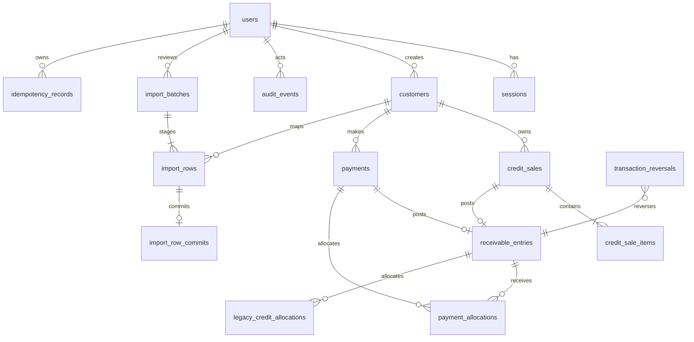

# ERD Fisik Baseline — PostgreSQL

**Status:** disepakati melalui ADR-007; skema migrasi wajib mengikuti ERD ini. Nama kolom memakai `snake_case`; ID adalah UUID; waktu audit disimpan UTC. Tidak ada `tenant_id` pada MVP karena aplikasi hanya melayani satu toko.

## Relasi

## Tabel dan constraint final

| Tabel | Field inti | Aturan utama |
|---|---|---|
| `users` | `id UUID PK`, `username TEXT UNIQUE`, `password_hash TEXT`, `role TEXT`, `is_active BOOL`, `must_change_password BOOL`, `created_at`, `updated_at` | `role IN ('owner','operator','viewer')`; password hanya berupa hash Argon2id. Password sementara memblokir akses sampai diganti. Minimal satu Owner aktif. |
| `sessions` | `id UUID PK`, `user_id UUID FK`, `token_hash BYTEA UNIQUE`, `created_at`, `last_seen_at`, `expires_at`, `revoked_at NULL` | Token mentah tidak disimpan; expiry absolut 12 jam dan idle 30 menit; logout/revoke langsung invalid. |
| `customers` | `id UUID PK`, `code TEXT NULL`, `normalized_code TEXT NULL`, `name TEXT`, `address TEXT NULL`, `is_active BOOL`, `version INT`, `created_by UUID FK`, `created_at`, `updated_at` | Nama trim nonempty; unique partial index pada `normalized_code IS NOT NULL`; tidak hard-delete. |
| `credit_sales` | `id UUID PK`, `customer_id UUID FK`, `effective_date DATE`, `reference_no TEXT NULL`, `backdate_reason TEXT NULL`, `status TEXT`, `total_idr BIGINT`, `version INT`, `created_by UUID FK`, `posted_by UUID FK NULL`, `created_at`, `posted_at NULL` | Status `draft/posted/reversed`; total >0; hanya draft dapat diedit; posting atomik membuat satu debit ledger. |
| `credit_sale_items` | `id UUID PK`, `sale_id UUID FK`, `ordinal INT`, `description TEXT`, `quantity NUMERIC(12,3)`, `unit_price_idr BIGINT`, `line_total_idr BIGINT` | Unique `(sale_id, ordinal)`; quantity >0; unit price ≥0; line total >0; immutability setelah sale posted. |
| `payments` | `id UUID PK`, `customer_id UUID FK`, `amount_idr BIGINT`, `received_date DATE`, `method TEXT`, `reference TEXT NULL`, `note TEXT NULL`, `status TEXT`, `created_by UUID FK`, `posted_at`, `reversed_at NULL` | Amount >0; method `cash/bank_transfer`; status `posted/reversed`; posting atomik membuat satu kredit ledger. |
| `receivable_entries` | `id UUID PK`, `customer_id UUID FK`, `entry_type TEXT`, `source_id UUID`, `effective_date DATE NULL`, `debit_idr BIGINT`, `credit_idr BIGINT`, `source_order BIGINT NULL`, `created_at`, `created_by UUID FK` | Exactly one of debit/credit >0; append-only; unique `(entry_type, source_id)`; source order dipakai untuk import legacy. |
| `payment_allocations` | `id UUID PK`, `payment_id UUID FK`, `debit_entry_id UUID FK`, `amount_idr BIGINT`, `status TEXT`, `created_at`, `created_by UUID FK`, `reversed_by UUID FK NULL`, `reason TEXT NULL` | Amount >0; payment dan debit harus milik customer sama; total allocation ≤ payment dan debit outstanding; reallocation berupa reversal + allocation baru. |
| `import_batches` | `id UUID PK`, `file_sha256 CHAR(64)`, `original_filename TEXT`, `status TEXT`, `uploaded_by UUID FK`, `approved_by UUID FK NULL`, `created_at`, `approved_at NULL`, `committed_at NULL`, `closed_at NULL`, `variance_idr BIGINT NULL`, `variance_reason TEXT NULL` | Status `uploaded/reviewing/approved/committed/closed_with_exceptions/failed`; hash duplikat tidak dapat commit ulang tanpa proses import revision yang eksplisit. |
| `import_rows` | `id UUID PK`, `batch_id UUID FK`, `sheet_name TEXT`, `row_number INT`, `source_customer JSONB`, `raw_values JSONB`, `parsed_values JSONB NULL`, `issues JSONB`, `review_status TEXT`, `mapped_customer_id UUID FK NULL`, `reviewed_by UUID FK NULL`, `review_reason TEXT NULL`, `committed_entry_id UUID FK NULL` | Unique `(batch_id,sheet_name,row_number)`; status `candidate/accepted/quarantined/excluded/committed`; PH-06 hanya transaksi dari sheet pelanggan bernama, identitas B1/B2 per sheet; saldo aging/formula tidak dipakai. |
| `audit_events` | `id UUID PK`, `actor_id UUID FK`, `action TEXT`, `entity_type TEXT`, `entity_id UUID`, `reason TEXT NULL`, `request_id UUID`, `occurred_at`, `metadata JSONB` | Append-only; mutasi uang, akses role, review/commit import dan reversal wajib audit; metadata tidak boleh berisi secret/raw workbook. |
| `idempotency_records` | `id UUID PK`, `actor_id UUID FK`, `route_key TEXT`, `idempotency_key TEXT`, `request_hash CHAR(64)`, `response_status INT`, `response_body JSONB`, `created_at` | Unique `(actor_id, route_key, idempotency_key)`; same key+same body replays response; same key+different body returns 409; retain with financial record retention. |
| `business_settings` | `key TEXT PK`, `value JSONB`, `updated_by UUID FK`, `updated_at` | MVP setting `business_timezone='Asia/Jakarta'`; perubahan hanya Owner dan audit. |

## Aturan ledger

Saldo piutang pelanggan = total debit posted dikurangi total kredit posted, bukan kolom/cache. Outstanding per debit dihitung dari alokasi aktif. Saldo kredit pelanggan = pembayaran posted dikurangi alokasi aktif. Reversal membuat entri lawan dengan referensi sumber; tidak menghapus entry asli. Pembayaran dan alokasi dibuat dalam satu transaksi PostgreSQL dengan row-level locking/constraint agar tidak over-allocate saat concurrent request.

Unique source + source ID menjaga satu ledger entry per transaksi. `source_order` pada event import diurutkan menurut ordinal sheet pelanggan lalu nomor baris sumber; semua raw/provenance harus dapat ditelusuri sampai keputusan reviewer.

## Migrasi PH-06/PH-07

[Migrasi 0005](../migrations/postgres/0005_imports_reversals.sql) menambah staging workbook (`import_batches`, `import_rows`) dengan hash unik dan byte sumber terbatas, review berversi, komit lineage `import_row_commits`, alokasi kredit historis, serta relasi reversal. [Migrasi 0006](../migrations/postgres/0006_import_customer_identity.sql) menyimpan kandidat identitas pelanggan per row. PH-06 menghitung net saldo dari transaksi bertanggal dan nominal debit/kredit literal pada sheet pelanggan bernama; sheet `Analisa`, saldo formula, dan aging formula diabaikan. Satu baris sumber maksimal satu event; exceptions dipertahankan. Commit Owner menerima kandidat valid dan membuat pelanggan baru serta event ledger atomik.

Koreksi transaksi posted membalik event dan alokasinya dengan kontra-event; replacement link bersifat opsional. Reallocation payment membalik alokasi lama lalu mencatat alokasi baru atau membiarkan kredit pelanggan, menggunakan versi payment untuk mencegah update usang.

## Implementasi PH-01

[Migrasi 0001](../migrations/postgres/0001_customer_ledger_foundation.sql) merealisasikan tabel `users`, `sessions`, `customers`, dan `receivable_entries`. Guard ledger mengizinkan perubahan tautan pelanggan untuk mendukung merge yang kelak diaudit dan melindungi kolom event lainnya dari perubahan. Tabel dan invariant lintas transaksi lainnya direalisasikan bersama alur yang menggunakannya. Kode pelanggan dinormalisasi di domain sebelum disimpan dan indeks unik PostgreSQL menangani benturan nilai ternormalisasi.

[Migrasi 0008](../migrations/postgres/0008_user_password_change.sql) menambah `users.must_change_password` dengan default `false`, sehingga akun yang sudah ada tetap dapat masuk tanpa forced reset. Akun baru dan reset Owner menetapkan flag tersebut.

## Implementasi PH-02

[Migrasi 0002](../migrations/postgres/0002_customer_slice.sql) menambahkan `payments`, `payment_allocations`, dan `audit_events`. API membaca alokasi aktif pada pembayaran posted dan debit pelanggan yang sama. Riwayat dan saldo dihitung dalam snapshot baca PostgreSQL. Merge mengunci kedua pelanggan, memindahkan tautan ledger dan pembayaran, menonaktifkan sumber, serta menulis audit dalam satu transaksi. Audit event dilindungi dari update/delete.

Posting dan mutasi payment/alokasi telah diimplementasikan pada PH-04; reversal/reallocation mengikuti PH-07. Relink historis untuk merge juga diterapkan di slice pelanggan.

## Implementasi PH-03

[Migrasi 0003](../migrations/postgres/0003_credit_sales.sql) menambahkan `credit_sales`, `credit_sale_items`, dan `idempotency_records`. API memakai lock per kunci retry dan lock pelanggan yang konsisten dengan merge. Total item dijaga constraint PostgreSQL, sedangkan kalkulasi domain menggunakan bilangan bulat. Status posted, satu debit ledger bertipe `credit_sale`, audit, dan respons idempoten di-commit bersama. Merge hanya mengganti tautan pelanggan pada penjualan posted dan ledger. Untuk draft yang dipindahkan, versi bertambah agar review lama tidak dapat diposting.

## Implementasi PH-04

[Migrasi 0004](../migrations/postgres/0004_payment_posting.sql) menambahkan index FIFO dan trigger validasi alokasi: payment harus posted, debit harus positif dan satu pelanggan, serta total aktif tidak boleh melampaui nominal payment atau debit. Alokasi baru append-only; reversal/reallocation tetap mengikuti PH-07. `POST /api/v1/payments` mengunci pelanggan, menghitung alokasi FIFO berdasarkan tanggal usaha, waktu posting, lalu UUID, dan menulis payment, alokasi, kredit ledger, audit, serta idempotency record dalam satu transaksi. Sisa payment disimpan sebagai kredit pelanggan. Kredit diterapkan hanya melalui API manual dengan alasan dan audit. Pembayaran bersamaan diserialkan pada lock pelanggan.
